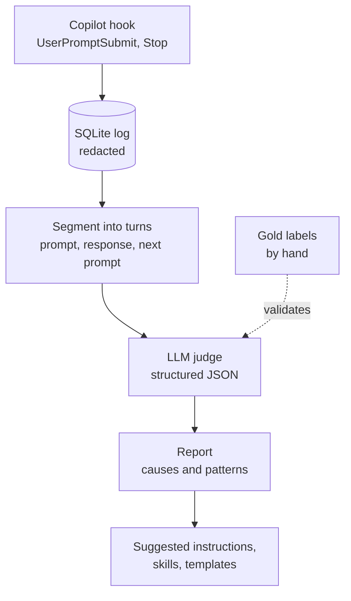

# promptlens

When a coding-assistant session needs another iteration, whose "fault" is it: the model, an incomplete prompt, or a genuinely new insight on the user's side? promptlens logs your prompts through Copilot hooks, classifies every follow-up turn with an LLM judge, and aggregates the causes so you can improve instructions, prompt templates, skills and agents with evidence instead of gut feeling.



## Taxonomy

| Category | Meaning |
|---|---|
| `llm_error` | The model ignored an explicit instruction, hallucinated, lost context, used the wrong format, or went out of scope. |
| `missing_user_input` | The requirement was never stated and a reasonable assistant could not know it. |
| `new_insight` | The user learned something (from the result, a test, a colleague) and changed the requirement. |
| `unclear` | Not enough evidence. |
| `none` | Not an iteration (new task or confirmation). |

The judge only evaluates what was knowable at the time of the original prompt, so hindsight does not turn missing input into model error.

## Quickstart

```bash
python -m venv .venv && source .venv/bin/activate
pip install -e ".[dev,openai]"
pytest

# try the whole pipeline without API calls
export PROMPTLENS_HOME=$(mktemp -d)
promptlens import-jsonl examples/demo_events.jsonl
promptlens judge --dry-run
promptlens report --model dry-run
```

With a real judge model:

```bash
export OPENAI_API_KEY=...
promptlens judge --model <your-model>      # or set PROMPTLENS_MODEL
promptlens report
```

## Hook setup

```bash
promptlens init-hooks --target /path/to/repo     # writes .github/hooks/promptlens.json
```

Or place the same file under `~/.copilot/hooks/` to log every repository. The hook calls `promptlens-hook`, which must be on the PATH of the editor process; otherwise put the absolute path to `.venv/bin/promptlens-hook` into the JSON.

Before relying on it, check what your Copilot version actually sends:

```bash
export PROMPTLENS_DUMP=/tmp/hook_payloads.jsonl   # raw payloads, unredacted: delete afterwards
```

The hook only appends rows. It never prints, never raises and does no model calls. Analysis is a separate batch step.

## Validate the judge before trusting it

```bash
promptlens export-gold --model <your-model> --n 50 --out gold.csv
# fill in the human_category column by hand
promptlens eval-gold gold.csv      # accuracy, Cohen's kappa, confusion matrix
```

Look at the confusion matrix first. The expected weak spot is `new_insight` vs `missing_user_input`. If it confuses them often, add few-shot examples from your own cases to `schema.SYSTEM_PROMPT`.

## Privacy

- Prompts and responses are redacted **before** they are written (API keys, tokens, JWTs, `password=` style assignments, URL credentials, emails, IPs) and again before they are sent to a judge.
- Add customer and project names, one per line, to `~/.promptlens/redact_terms.txt`.
- Pattern-based redaction is a safety net, not a guarantee. For client or government work, check your employer's policy first, and use your own sessions for demos.
- Everything stays in one local SQLite file (`~/.promptlens/log.db`, override with `PROMPTLENS_DB` or `PROMPTLENS_HOME`).

## Layout

```
src/promptlens/
  log_hook.py   hook entrypoint, transcript parsing, redacted insert
  redact.py     secret and term redaction
  segment.py    events -> turn triples
  schema.py     judge prompt, strict JSON schema, result validation
  judge.py      batch judge with pluggable backend
  report.py     aggregation, suggested fixes
  gold.py       gold-set export and judge evaluation
  cli.py        promptlens command
tests/          pytest suite (no network)
examples/       demo events and generated hook config
```

## Limitations

- The Copilot transcript format is not a stable API. Response extraction is best effort and falls back to no response; the judge then works from the two prompts alone.
- A `Stop` hook may fire before the transcript is fully flushed, so the last response can occasionally be missing.
- One primary cause per turn. Mixed causes are forced into a single label.
- LLM judges carry bias. Treat counts as a signal and check them against your gold set.

## Roadmap

1. Collect real sessions, build a gold set of 50+ turns, report accuracy and kappa here.
2. `promptlens suggest`: turn recurring patterns into draft instructions and skills, with the supporting turns attached.
3. Measure impact: iterations per task before and after adopting a generated instruction.
4. Small dashboard for patterns over time.
